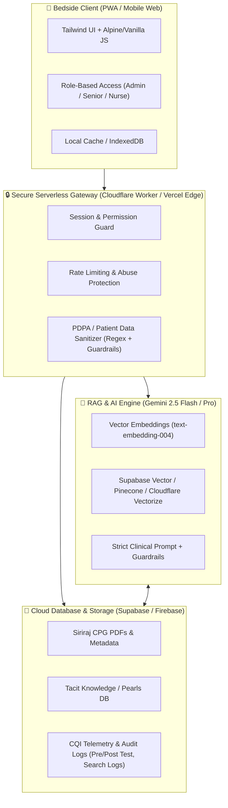

# 📋 แผนยุทธศาสตร์และแผนงานพัฒนาระบบ CCU Nurse AI Assistant (6 เดือน)
**โครงการนวัตกรรม CQI / R2R หอผู้ป่วยวิกฤตโรคหัวใจ (CCU) โรงพยาบาลศิริราช**  
**ผู้วิจัยและพัฒนานวัตกรรม:** นางสาวฟ้าพายัพ อินถาเครือ (พยาบาลวิชาชีพปฏิบัติการ CCU ศิริราช)  
**สถาปนิกและผู้ช่วยพัฒนา:** ก้อง (AI Engineering Assistant)

---

## 🎯 1. วัตถุประสงค์และเป้าหมายเชิงประจักษ์ (Goals & Success Metrics)

1. **ลดเวลาค้นหาแนวทางรักษา/ขนาดยาฉุกเฉิน (Bedside Speed):** จากเดิมเฉลี่ย 3-5 นาที ให้เหลือ **< 30 วินาที**
2. **ความแม่นยำทางคลินิก (Zero-Hallucination & Clinical Grounding):** การตอบคำถามทางคลินิกต้องอ้างอิง CPG ศิริราช **100% มีหลักฐานอ้างอิงกำกับ** และผ่านการตรวจสอบความถูกต้องโดย APN/แพทย์ $\ge 90\%$
3. **ความมั่นใจของพยาบาลจบใหม่ (Junior Nurse Empowerment):** คะแนนความมั่นใจในการดูแลผู้ป่วยวิกฤตเพิ่มขึ้นไม่น้อยกว่า **15%** (วัดจาก Pre-test / Post-test)
4. **งบประมาณ (Zero Hospital Budget):** พัฒนาบนโครงสร้างพื้นฐานแบบ Serverless / Free-tier / Self-funded API Token (ค่าใช้จ่าย 0 บาทต่อโรงพยาบาล)

---

## 🏗️ 2. สถาปัตยกรรมระบบเป้าหมาย (Target System Architecture)

---

## 📅 3. แผนการดำเนินงาน 6 เดือน (พฤศจิกายน 2569 – เมษายน 2570)

### 🔹 เดือนที่ 1 (พ.ย. 2569): Phase 1 – รวบรวมคลังข้อมูล & วางฐานข้อมูล Cloud (Foundation & Data Prep)
* **ภารกิจหลัก:**
  1. จัดหมวดหมู่เอกสาร CPG ศิริราช 29 ฉบับ, WI, และตารางขนาดยา High Alert Drugs เป็นรูปแบบ Structured Markdown / JSON
  2. เชื่อมต่อระบบ Authentication และ Cloud Database (Supabase PostgreSQL / Firestore) ทดแทน localStorage เพื่อให้พยาบาลใช้งานข้ามอุปกรณ์ได้จริง
  3. ออกแบบระบบป้องกันข้อมูลผู้ป่วย (PDPA / Sanitization Filter) ตัดชื่อ, HN, เตียงผู้ป่วย ก่อนส่งคำถามเข้าสู่ระบบ AI

### 🔹 เดือนที่ 2 (ธ.ค. 2569): Phase 2 – พัฒนาระบบ RAG จริง (Production RAG & Vector Engine)
* **ภารกิจหลัก:**
  1. สร้าง Chunking & Embedding Pipeline (Siriraj CPGs -> Text Chunks -> Embeddings)
  2. เชื่อมต่อ Gemini 2.5 API ผ่าน Serverless Secure Proxy เพื่อซ่อน API Key ไม่ให้รั่วไหล
  3. ปรับแต่ง Prompt Engineering ขั้นสูง:
     - ตอบเฉพาะข้อมูลที่มีใน CPG ศิริราชเท่านั้น
     - กำกับเอกสารอ้างอิง (เล่ม/หน้า/ปีที่ประกาศใช้) ในทุกคำตอบ
     - มีปุ่มเตือน "Double Check With In-Charge/Physician" สำหรับยาช่วยฟื้นคืนชีพและ High Alert Drugs
  4. ทำระบบ Offline Mode / PWA (Add to Home Screen) สำหรับจุดอับสัญญาณในวอร์ด

### 🔹 เดือนที่ 3 (ม.ค. 2570): Phase 3 – สอบเทียบความถูกต้อง & Pre-test (Clinical Verification & Baseline)
* **ภารกิจหลัก:**
  1. นำชุดทดสอบ 50 คำถามคลินิกจริง (Golden Test Set) ให้ APN, พยาบาลผู้เชี่ยวชาญ และ In-charge ตรวจสอบความถูกต้อง (ต้องผ่าน $\ge 90\%$)
  2. พัฒนาระบบประเมินผลในแอป: ระบบทำแบบทดสอบก่อนใช้งาน (Pre-test) วัดความรู้และความมั่นใจของพยาบาลกลุ่มตัวอย่าง
  3. จัด Workshop สั้นๆ (15-20 นาที) แนะนำการใช้งานแก่พยาบาล CCU ทุกกะ (เวรเช้า/บ่าย/ดึก)

### 🔹 เดือนที่ 4 (ก.พ. 2570): Phase 4 – เริ่มใช้งานจริงข้างเตียง (Bedside Clinical Pilot Launch)
* **ภารกิจหลัก:**
  1. เริ่มใช้งานจริงข้างเตียงผู้ป่วย CCU โดยพยาบาลวิชาชีพทั้ง 4 กะ
  2. เปิดใช้งานระบบ **Clinical Pearls (Tacit Knowledge)** ให้พยาบาลแลกเปลี่ยนเทคนิคหน้างาน โดยมี Senior/APN เป็นผู้กลั่นกรองและอนุมัติ (Peer-Review System)
  3. มอนิเตอร์ระบบ Telemetry: บันทึกสถิติคำถามยอดฮิต, เวลาเฉลี่ยในการค้นหา, และปัญหาระบบหลุด/ขัดข้อง

### 🔹 เดือนที่ 5 (มี.ค. 2570): Phase 5 – ประเมินผลหลังใช้งาน & เก็บข้อมูลวิจัย (Post-test & CQI Evaluation)
* **ภารกิจหลัก:**
  1. ให้กลุ่มตัวอย่างทำแบบทดสอบหลังใช้งาน (Post-test) และแบบประเมินความพึงพอใจ/ความมั่นใจ
  2. วิเคราะห์สถิติเปรียบเทียบ Pre vs Post:
     - ความถูกต้องในการตัดสินใจและการเลือกขนาดยา
     - เวลาเฉลี่ยในการเข้าถึงข้อมูล CPG
     - อัตราความคลาดเคลื่อนทางยา (Medication Error / Near Miss)
  3. ปรับแต่งระบบเพิ่มเติมตามข้อเสนอแนะของพยาบาลหน้างาน

### 🔹 เดือนที่ 6 (เม.ย. 2570): Phase 6 – สรุปงานวิจัย & เตรียมประกวดนวัตกรรม (Dissemination & Scale-up)
* **ภารกิจหลัก:**
  1. จัดทำรายงานสรุปผลโครงการ CQI/R2R ฉบับสมบูรณ์
  2. เตรียมโปสเตอร์และสื่อนำเสนอสำหรับงาน **Siriraj Quality Fair** และการประชุมวิชาการพยาบาล
  3. จัดทำคู่มือการขยายผล (Scale-up blueprint) สำหรับนำระบบไปประยุกต์ใช้กับหอผู้ป่วยวิกฤตอื่นๆ เช่น ICU อายุรกรรม, ICU ศัลยกรรม, หรือหอผู้ป่วยกึ่งวิกฤต (Step-down)

---

## 🛡️ 4. มาตรการความปลอดภัยและจริยธรรมทางการแพทย์ (Medical Governance)

| มิติความปลอดภัย | มาตรการที่กำหนดในระบบ |
| :--- | :--- |
| **การป้องกันข้อมูลผู้ป่วย (PDPA)** | ห้ามพิมพ์ชื่อ นามสกุล HN หรือเลขอัตลักษณ์ผู้ป่วย ระบบมีตัวดักจับ Regex และแจ้งเตือนทันที |
| **การป้องกันภาพหลอน (Hallucination)** | Strict Context Restriction: หากไม่มีข้อมูลใน CPG ศิริราช ระบบจะตอบว่า "ไม่พบแนวทางใน CPG ศิริราช กรุณาปรึกษา In-charge หรือแพทย์เจ้าของไข้ทันที" |
| **สิทธิ์การจัดการข้อมูล (RBAC)** | พยาบาลทั่วไปค้นหาและแชร์เทคนิคได้ / พี่ Senior ตรวจสอบความถูกต้อง / Admin จัดการผู้ใช้งานและโครงสร้าง CPG |
| **Audit Trail & Logging** | บันทึกประวัติการสืบค้นและคำถามที่พบบ่อยโดยไม่ระบุตัวตน (Anonymized) เพื่อนำไปวิเคราะห์ประเด็นที่ต้องจัดอบรมเพิ่มเติมในวอร์ด |

---

## 📌 5. แผนการเริ่มงาน Sprint ถัดไป (Next Action Steps)

1. **Sprint 1 (ทันที):** จัดโครงสร้างไฟล์และเตรียมเชื่อมต่อ Cloud Database (Supabase) สำหรับ User Auth & CPG Metadata
2. **Sprint 2:** ติดตั้ง Serverless API Proxy เพื่อต่อเชื่อม Gemini API สำหรับค้นหาข้อมูล CPG อัตโนมัติ
3. **Sprint 3:** สร้างหน้าจอทำแบบทดสอบ Pre/Post Test สำหรับงานวิจัย R2R ในตัวเว็บ
